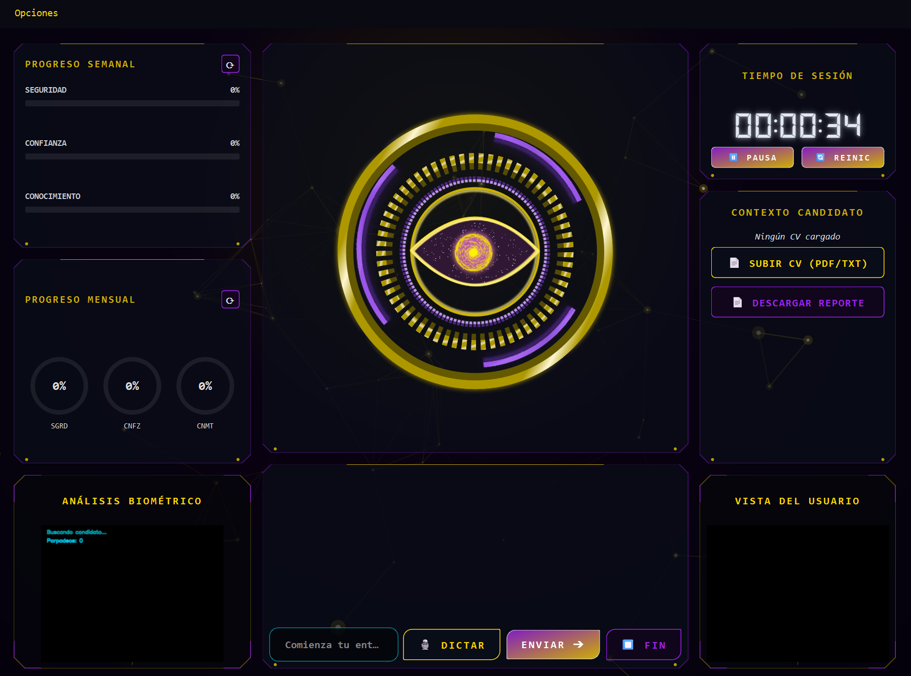
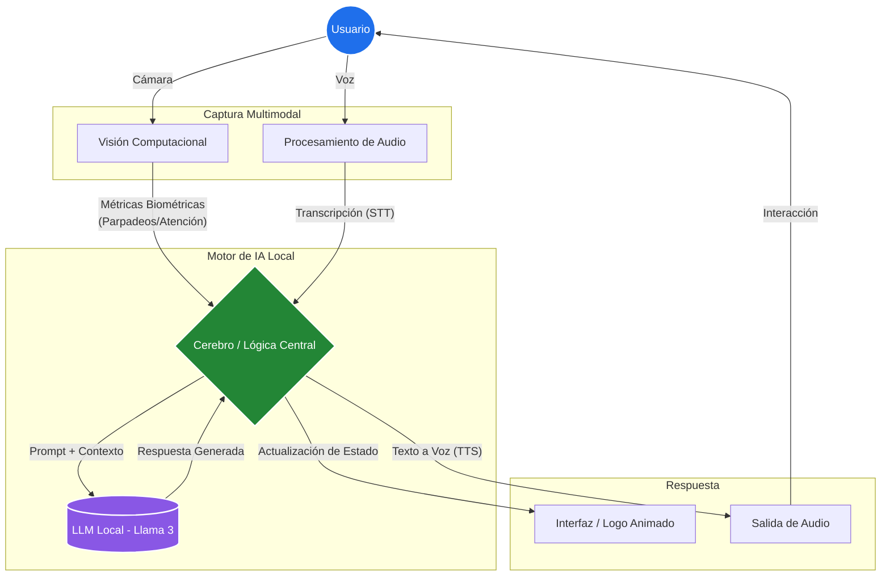

# 🧠 Nira: AI Personal Instructor & Biometric Interviewer

  

### Demostración en Vivo

  

## 📌 Visión General
**Nira** es una aplicación impulsada por Inteligencia Artificial diseñada para simular entrevistas de estrés de alta exigencia. A diferencia de un chatbot tradicional, Nira analiza en tiempo real las respuestas y biometría del usuario para generar interacciones dinámicas, evaluando tanto la capacidad técnica como el manejo de la presión.

## ✨ Características Principales
* **Análisis Biométrico y Microexpresiones:** Procesamiento de datos en tiempo real para adaptar la actitud del entrevistador según el nivel de estrés detectado.
* **Procesamiento de Audio Bidireccional:** Generación de respuestas dinámicas por voz.
* **Privacidad (estado actual):** el modelo de lenguaje (Llama 3) corre 100 % en local con Ollama, así que las preguntas, respuestas y el CV que se carga no salen del equipo. **Pendiente:** la transcripción de voz usa la API de Google (SpeechRecognition) y la voz sintética usa Edge TTS de Microsoft, así que el audio y el texto hablado sí se envían a esos servicios. Próximo paso: reemplazarlos por Whisper (local) y Piper TTS (local) para que todo el flujo funcione sin conexión.
* **Interfaz Dinámica:** UI reactiva con animaciones SVG integradas.

##  Arquitectura del Sistema

## Cómo lo construí
Diseñé la idea, el flujo y la arquitectura, y escribí el código con asistencia de herramientas de IA. Mi trabajo fue definir qué debía hacer cada módulo, probarlo, corregir errores y documentarlo.

## Qué aprendí
- Separar la interfaz (PyQt6) del procesamiento pesado con hilos (`QThread`) para que la app no se congele.
- Correr un LLM en local con Ollama.
- Que "local" hay que verificarlo módulo por módulo: el reconocimiento de voz y la voz sintética usan servicios en la nube.

**Flujo de Datos:**
1. Captura de inputs (Voz y Biometría de video).
2. Procesamiento local y extracción de métricas.
3. Ingesta de contexto hacia el modelo Llama 3.
4. Generación de respuesta (Texto a Voz) y actualización de interfaz (SVG).

##  Stack Tecnológico
* **Lenguaje Core:** Python 3.x
* **Frontend (Desktop UI):** PyQt6 (Multithreading asíncrono) | PyQt6.QtSvg | Pygame
* **Visión Computacional:** OpenCV (`cv2`) | MediaPipe (Face Mesh & Pose) | NumPy
* **Motor de IA Local:** Ollama (Llama 3 local inference)
* **Procesamiento de Audio:** SpeechRecognition (STT) | Edge TTS (Voces neuronales)
* **Ingesta de Datos:** PyMuPDF (`fitz`) | python-docx (Extracción de contexto desde CVs)

---
*Desarrollado por Luis - Integrando Arquitectura Cloud, IA y Ciberseguridad.*
